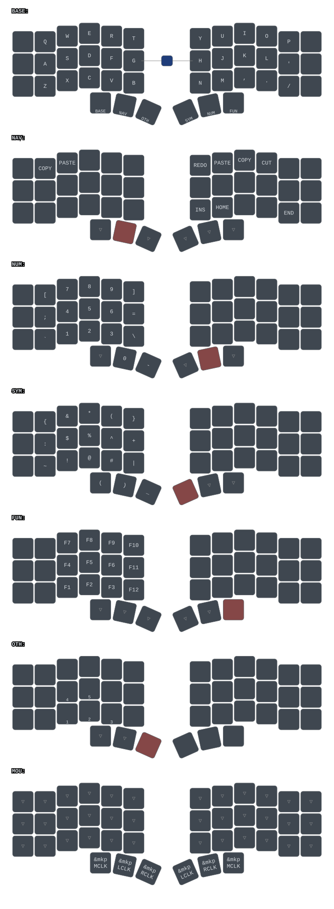

# ZMK config for beekeeb Toucan2 Keyboard

[The beekeeb Toucan2 Keyboard](https://beekeeb.com/introducing-toucan2/) is a wireless split 42-key column‑stagger keyboard that a display and a trackpad, with an aggressive stagger on the pinky columns.

# Customizations

- **Keymap**: [config/toucan.keymap](config/toucan.keymap)
- **General configs**: [boards/shields/toucan/toucan_left.conf](boards/shields/toucan/toucan_left.conf) and [boards/shields/toucan/toucan_right.conf](boards/shields/toucan/toucan_right.conf)
- **Swipe shortcuts**: the `swipe_button_mapper` node in [boards/shields/toucan/toucan.dtsi](boards/shields/toucan/toucan.dtsi)
- **Invert scroll / trackpad settings**: the `tps43_trackpad` node in [boards/shields/toucan/toucan_right.overlay](boards/shields/toucan/toucan_right.overlay)

# Keymap

Auto-generated with [keymap-drawer](https://github.com/caksoylar/keymap-drawer) on every keymap change (see [keymap-drawer.yaml](.github/workflows/keymap-drawer.yaml)).

# Home row mods

The home row mods (`hml` and `hmr` in [config/toucan.keymap](config/toucan.keymap)) follow the "timeless" approach from [urob's zmk-config](https://github.com/urob/zmk-config#timeless-homerow-mods), so they depend as little as possible on typing speed:

- `flavor = "balanced"`: a mod becomes a hold when another key is pressed *and released* while it is held, so there is rarely a need to wait for the timer.
- `hold-trigger-key-positions` with `hold-trigger-on-release`: only a key on the opposite hand or a thumb (`KEYS_L`, `KEYS_R`, `THUMBS`) can turn a mod into a hold, so quick same-hand rolls type letters.
- `require-prior-idle-ms`: a mod pressed shortly after another key resolves immediately as a tap while typing.
- `tapping-term-ms = <280>`: only matters when holding a mod alone, or combining a mod with a key on the same hand (hold the mod this long first).

Tuning, using ZMK's USB logging below to see how each press resolved:

- Delay when tapping a mod: raise `require-prior-idle-ms` (urob suggests at least `10500 / your relaxed WPM`).
- Mod doesn't trigger after fast typing: lower `require-prior-idle-ms`.
- Same-hand shortcuts don't trigger: lower `tapping-term-ms`. Same-hand mods trigger by accident: raise it.

# Debugging with USB logging

Use ZMK's `zmk-usb-logging` snippet (not `CONFIG_ZMK_USB_LOGGING=y` alone, which fails to build: it needs the CDC-ACM devicetree node the snippet adds, and USB is unavailable on the split peripheral/right half). Flash the `toucan_left_usb_logging` firmware artifact (a separate left-half entry in `build.yaml` using that snippet) instead of the regular left firmware. The left half already uses `studio-rpc-usb-uart`, which claims the same USB serial port, so the logging build omits Studio. It shows each key position and whether a home row mod resolved as tap or hold. Remove it when done, since it increases power use and can add latency.

**Reading the log by OS**

- **macOS:** `screen /dev/tty.usbmodem* 115200`
- **Linux:** `screen /dev/ttyACM0 115200` (you may need to be in the `dialout` group)
- **Windows:** Open PuTTY or Tera Term, choose Serial, pick the COM port shown in Device Manager, and set 115200 baud.
- **Any OS:** The `serial-monitor` extension in VS Code, or `python -m serial.tools.miniterm <port> 115200` (requires `pyserial`).

**Caveats**

- The keyboard must be connected over USB. The log doesn't come through Bluetooth.
- Only the half you plug in logs its own events. On a split keyboard, the central half (usually left) also reports the other half's key presses.
- If you use ZMK's `zmk-usb-logging` snippet instead, the config line isn't needed, but your build setup must support snippets.

# License

The code in this repo is available under the MIT license.

The included shield nice_view_gem is modified from https://github.com/M165437/nice-view-gem licensed under the MIT License.

The linked trackpad module is based on https://github.com/geeksville/zmk_driver_azoteq

ZMK code snippets are taken from the ZMK documentation under the MIT license.

The embedded font QuinqueFive is designed by GGBotNet, licensed under under the SIL Open Font License, Version 1.1.
